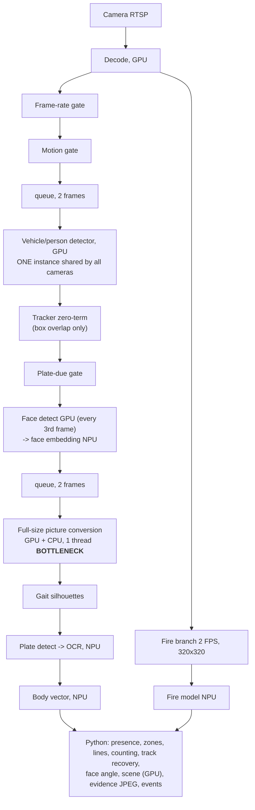
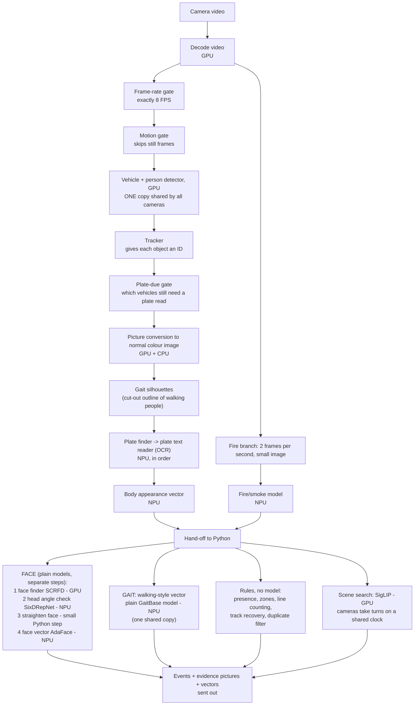

# T2 design review: what we planned vs what is built

Date 2026-11-17. Source: T2 image code (`image/t2full_local/`, base runtime `image/c12_extract/services/worker/pipeline/`),
.64 run data (`t2_campaign/results_64/`, `t2_profiling/data/`). Every line below is from code or measured data.
Status: **OK** = checked and working, **PROBLEM** = checked and wrong/limiting, **NOT VERIFIED** = never measured,
**MISSING** = not designed.

## 1. The pipeline as built (one camera)

Face, gait, plate and body work as an assembly line (different frames at the same time), not side by side on the same frame.
All of them wait for the single picture-conversion step.

## 2. Stage by stage

| Stage | Planned | Built (code) | Evidence | Status |
|---|---|---|---|---|
| Decode | GPU decode | `vah264dec`/`vah265dec` | Video engine 2-12% at 1-6 cams | OK |
| Frame-rate gate | exact FPS per camera | `sentinelrategate` | cameras at 7.97-8.0 FPS | OK |
| Motion gate | skip quiet frames | `gvamotiondetect` | quiet -> people -> quiet test passed | OK |
| Detector | shared, fast | one inference instance for all cameras, a 2-frame queue after face step | at 5 cams frames wait 0.41 s before it while GPU 55% busy | **PROBLEM**: one slow camera holds all cameras |
| Tracker | keep object until it leaves | `gvatrack zero-term` (box overlap, no appearance) | people video 1 cam, 143 s: 255 track losses; ANPR video 5 cams: 1,956 losses; 49-66 breaks/min | **PROBLEM**: breaks often; never measured against ground truth |
| Track recovery, people | face/body/position | body vector cosine >= 0.78 + position within limit + inside end timeout; refuses if top two within 0.04 (`v8_events.py:515`) | 119 of 255 losses recovered (47%) | **PARTLY**: face and gait not used |
| Track recovery, vehicles | ANPR/position | position + size ratio <= 2.4 + type, within 12 s (`v8_events.py:538`) | 1,047 of 1,956 recovered (54%) | **PARTLY**: plate text not used |
| Recovery timing | any time | only tried on the first frame a new track ID appears; people need a body vector on that exact frame, else a new presence is created (`v8_events.py:754`, `:517`) | not measured | **NOT VERIFIED**: likely gap |
| Dedup | no repeated outputs | plates: same text only re-sent if confidence improves + cooldown (`:1501`); face/body samples: quality improvement + cooldown (`:1081`); face duplicates by embedding (`face_samples.py`) | code only | **NOT VERIFIED** by measurement |
| Face | angle-gated face ID | SCRFD every 3rd frame (GPU) -> embedding (NPU); angle in Python | face success ratio reads **0.0 on every people video, in C18 and T2**, which keeps identity in `tolerant_collection` | **NOT VERIFIED**: possible metric bug |
| Body | sample per track | every ~1 s per track, NPU | ~8.8 vectors/s on people video | OK (interval 0.9 s needs sign-off) |
| Gait | only when useful | gait gate | 48 eligible vs 524 skipped (1 cam) | OK |
| Crops | from original frame | whole 1080p frame converted on CPU (1 thread) every frame, then cropped | 57-65 ms/frame mean, 115 ms worst 5% at 4 cams (budget 125 ms) | **PROBLEM**: main bottleneck |
| Presence/counting cams | logic only | still get a full-size picture every frame (8/s) | presence 9 cams vs scene+fire 13 cams | **PROBLEM** |
| Plate gate | adaptive | `sentinelstate`: skips 30-41% of checks; vehicle >= 80 px wide | 80 px picked from 2 videos (ANPR.mp4, traffic1) | **WEAK**: fixed pixels, not per camera |
| Plate -> OCR | in order | `sentinelplate` | ANPR 95 reads vs C18 83 | OK (needs sign-off) |
| Fire | alarm + clear | 2 FPS branch, NPU, balanced rule | 4 alarms / 3 clears = C18 | OK; evidence image only 320x320 |
| Scene search | spread over time | spread ON (`SENTINEL_SCENE_SPREAD=1`), offset from camera name; event scenes skip it; SigLIP on **GPU** | ~0.5 samples/s/cam | OK; collisions possible; could run on NPU |
| Adaptive policy | adjust to each camera | switches modes from measurements (`adaptive_policy.py`) | people video: tracking `tolerant_collection` (frequent fragmentation); camera01 live: `balanced` | OK, but mostly reacting to tracker breaks |
| Scheduling | planned budget across cameras | none: each camera runs its own pipeline, shared models first-come-first-served; only scene spread + pending-frame brake | — | **MISSING** |
| Contract outputs | correct | same counts as C18 on 6 test videos | no ground-truth check | **NOT VERIFIED** for accuracy |

## 3. Testing so far
- The test list copies C18's capacity matrix: it finds "how many cameras pass" and repeats points. It never checked design
  questions (tracking quality, gate values, recovery, accuracy).
- Profiling (per-step time, per-thread CPU, GPU engines, NPU) was added only on 2026-11-17 (`t2_profiling/`).

## 4. What to check next (each answers one open question, no blind repeats)
1. **Tracker quality**: MOT17 ground truth -> ID switches, lost tracks, and how many the recovery fixes.
2. **Recovery gap**: count new presences created because no body vector existed on the first frame.
3. **Face success metric**: log due vs detected per evaluated frame; confirm whether 0.0 is real or a counting bug.
4. **80 px plate gate**: plate reads at 40/60/80/100 px on labelled plates, at more than one camera resolution.
5. **Accuracy**: counts, line crossings, plates against labelled clips.
6. **Bottleneck fix** (conversion threads, crop on GPU, no full picture for presence cams, queue after detector, scene on NPU),
   then one profiled run per change.

## 5. Check results (2026-11-17)

### Check 1 - tracking quality (MOT17, 7 labelled videos, 8 FPS, T2 detector + gvatrack zero-term, `tests/tracking_eval/`)
TrackEval, pedestrians, 541 labelled people:

| Variant | HOTA | IDF1 | MOTA | ID switches | IDs made | recall | precision |
|---|---|---|---|---|---|---|---|
| tracker IDs (raw) | 37.4 | 45.6 | 33.3 | 393 | 772 | 38.0% | 91.7% |
| + runtime recovery rules (replica of `v8_events`, balanced) | 37.1 | 45.0 | 33.3 | 390 | 718 | 38.0% | 91.7% |
| + recovery, tolerant | 37.1 | 45.0 | 33.3 | 390 | 724 | 38.0% | 91.7% |
| what-if: recovery on any frame, not only the first | 36.4 | 43.6 | 33.2 | 427 | 730 | 38.0% | 91.7% |

- The detector finds only 38% of labelled people (crowds, small, occluded); what it finds is right 92% of the time.
- Recovery rejoins 48-54 tracks (of ~200 lost); it removes ~50 extra IDs but does not improve ID accuracy (IDF1 45.6 -> 45.0).
- 167-206 new tracks had no body vector (too small or low quality), so they can never be rejoined.
- "First frame only" gap: allowing recovery on later frames makes it worse (more wrong joins). Not worth fixing as is.
- Note: recovery here is a replica of the runtime rules on recorded detections, not the runtime itself.
- (Earlier V6 test on the older detector: HOTA 31.4, IDF1 35.2. T2's detector is better.)

### Check 2 - counting (same MOT17 data; vertical centre line and left-half zone; confirmed tracks >= 4 hits)
| | unique people | line crossings | zone entries |
|---|---|---|---|
| ground truth | 469 | 135 | 327 |
| T2 tracker | 322 (-31%) | 96 (-29%) | 225 (-31%) |
| T2 + recovery | 296 (-37%) | 98 (-27%) | 215 (-34%) |
Without the >= 4 hits rule, unique people is +41..51% (broken tracks counted again). On crowded scenes T2 undercounts mainly
because the detector misses people. No labelled counting data exists locally (AI City folder has descriptions, no videos).

### Check 3 - face success measure
On MOT17-02 at 8 FPS with the T2 face chain: on frames the face model actually runs (every 3rd), 1.6 faces for 7.2 people,
median 20% of people have a face; on the other frames 0. The runtime reports 0.0 because it measures only people still
"due" for a face (people already sampled leave the due list), i.e. mostly people whose face is not visible. Both 0.0 and
0.20 are below the 0.40 rule, so identity stays in `tolerant_collection` on crowded cameras either way. Metric design, not a crash.

### Check 4 - plate size rule (71 human-verified plates, vehicle image shrunk to each width, exact T2 plate+OCR chain)
| vehicle width | correct plate text | WRONG text with confidence >= 0.82 |
|---|---|---|
| original (900-2250 px) | 86% | 10 |
| 600 px | 79% | 15 |
| 400 px | 69% | 21 |
| 320 px | 56% | 25 |
| 240 px | 20% | 39 |
| 160 px | 1% | 5 |
| 80-120 px | 0% | 0-1 |
By plate width: < 40 px about 0%, 40-50 px 12-28%, >= 60 px 62-92%.
- The 80 px vehicle rule never blocks a readable plate, but it lets through vehicles up to ~300 px that cannot be read.
- OCR confidence is not a safe signal: small plates give wrong text with confidence >= 0.82 (the v8 rule accepts a single
  read >= 0.82). A plate-width rule (>= 60 px) would block most wrong reads.
- Caveat: shrinking sharp snapshots is a stand-in for distance; real distant plates also have blur and compression.

### Check 5 - dedup
- Same plate + same presence: never repeated (0 repeats). Feature samples: max 5 per person.
- Same plate text on a DIFFERENT presence within 8 s : 14 of 95 reads on ANPR video (15%), 2 of 14 on
  traffic2. Vehicle recovery does not use plate text and there is no cross-presence plate dedup.
- CORRECTION 2026-11-18 (runs f2-SV-anpr-rec0/rec1, `tests/fix2/runs/`): the cause is NOT a track break. In 15 of 15 (rec0)
  and 17 of 17 (rec1) duplicates the OLD track was still tracked (no track_lost) when the new track read the same plate;
  some pairs are read 0.0-0.1 s apart at almost the same place (e.g. tracks 5 and 12). So one vehicle carries two live
  track IDs at once. The same 4 plates cause it on every loop of the video. Plate-text recovery (fix 2c) cannot and must
  not merge two live tracks.

### Check 6 - scene spread collisions
Offsets come from a hash of the camera name. With 8 cameras the closest two are 0.3% of the interval apart (2 pairs
within 1%); with 20 cameras 5 pairs within 1%. Even slots by camera order would keep them apart.

### Check 7 - bottleneck fixes (.64, all apps, 8 FPS) - stopped early at the user's request
- 4 conversion threads (setting only), 5 cams: still fail (6.7-7.1 FPS). The conversion thread drops from ~60% to ~33% busy, but
  the shared detector's threads then reach 99.7%.
- One detector per camera (test image v8-t2-fix1, `SENTINEL_MODEL_SHARD_SIZE=1`) + 4 threads, 5 cams: worse. Frames are taken at
  8 FPS but only 6.2-6.3 FPS finish (77-79%), GPU 84%, backlog 11. **This repeats a decision already made in V6 DEV27**
  (per-camera inference -> CL_OUT_OF_RESOURCES -> shared inference). Should not have been re-tested. Shared detector stays.
- Not run: scene on NPU, 6-camera points.

## 6. Architecture now (image `localhost/sentinel-cv:v8-t2-fix2f` on .64, 2026-11-18)
Checked against the code in `image/t2fix2/` (surface_stream.py, person_reid.py, v8_events.py, openvino_face.py).
One line per camera; the vehicle/person detector is ONE copy shared by all cameras of a worker.

What changed from T2:
- Face: the graph face chain (`scrfd_top1x_u8` with the 1.6x box built in, `face_align_u8` with alignment built in) is
  removed. Face now runs as 4 separate plain steps (scrfd_500m GPU, SixDRepNet best_a0_fp16 NPU, alignment in Python,
  adaface_ir101_int8 NPU), only for people still due a face, with one shared copy of each model per worker. Removing
  face from the shared GPU graph is the main reason all apps at 8 FPS went from 3-4 to 5 cameras.
- Gait: silhouettes are still cut out in the graph (sentinelgait); the walking-style model is the plain gaitbase_int8
  (one shared copy), not the montage wrapper with built-in reshaping.
- Scene search: each camera has a fixed turn on a shared wall clock (8 cams, 2 s interval -> one scene search every
  0.25 s), samples per camera unchanged (73-74 per run).
- Optional switches, default OFF: queue after the detector (`SENTINEL_T2_POSTDET_QUEUE`), oldest-frame-first
  (`SENTINEL_GVA_SCHEDULING_POLICY=latency`), plate-text recovery (`SENTINEL_PLATE_RECOVERY`).

Unchanged: plate finder before plate reader (in order); face, body and gait run side by side from the same picture;
presence and counting are logic only.

Devices: GPU = decode, detector, picture conversion, face finder, scene search. NPU = plate finder, plate reader, body,
gait, face vector, head angle, fire. CPU = part of the picture conversion and the Python rules.

Measured limits (all apps, 8 FPS, .64): 5 cameras pass; 6 at the edge (averages pass, one 10 s window 69 %).

Still weak (measured, not fixed):
1. One shared detector: when it falls behind, all cameras slow together (limit at 6 cameras).
2. Every frame of a people/vehicle camera is converted to a full picture even when nothing needs it (spec §4, not built).
3. The detector finds 38 % of people on crowded MOT17 videos (model work, user decision).
4. Duplicate plate reads come from two live tracks on one vehicle (not yet fixed).
5. One startup stall of the graph worker in 15 starts (watchdog recovered it; cause unknown).
